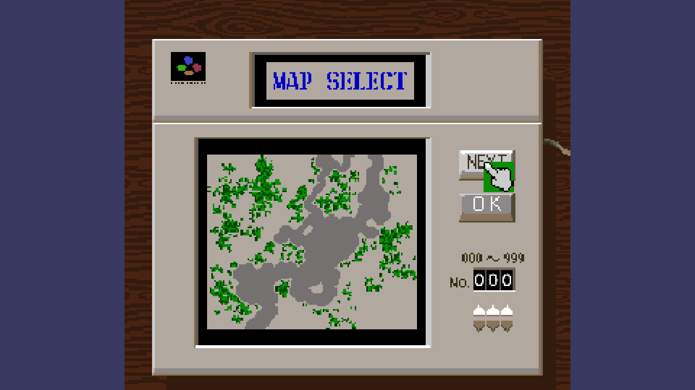

# Mode 7 City

City builder em 16 bits feito em Unity, inspirado no [SimCity](https://pt.wikipedia.org/wiki/SimCity_(jogo_eletr%C3%B4nico_de_1989)) de Super Nintendo (1991): o menu de escolha dos 1.000 mapas, o nome da cidade e do prefeito e, a partir daí, a cidade. O caminho é primeiro refazer a mecânica do SimCity inteira e, depois, remodelar o jogo com ideias e arte próprias.

**Andamento e tarefas:** [quadro do projeto](https://github.com/users/guavovic/projects/5) · [issues](https://github.com/guavovic/mode-7-city/issues)

  

## Como está sendo feito

O jogo começou em 2024 como um protótipo dos menus e do mapa. Em 2026 ele foi reorganizado numa arquitetura própria para jogos Unity, antes de a mecânica da cidade começar, com cada decisão registrada num ADR.

- **Migração sem parar o jogo:** o código antigo foi trocado área por área, com o jogo abrindo em todo commit. De 29 violações das regras de arquitetura para zero.
- **Regras conferidas por testes:** testes de arquitetura varrem o código e falham se aparecer singleton, busca de objeto por nome, `Resources` ou o input antigo.
- **Uma feature por pasta:** cada parte do jogo tem o próprio assembly e os próprios testes, e as partes se falam por eventos e interfaces.
- **Mapa em dados:** o terreno é uma grade em C# puro, testada sem cena, desenhada num Tilemap. Os 12.000 objetos que o mapa criava viraram um.
- **Simulação no ritmo do original:** o relógio roda as fases da simulação como o SimCity, com mês e ano a partir de janeiro de 1900.
- **Arte própria:** toda a arte vai ser refeita num estilo 16 bits próprio, com tiles de 16×16.

## Créditos

- **SimCity** é marca da Maxis e da Electronic Arts; a versão de Super Nintendo foi publicada pela Nintendo. Mode 7 City é um projeto independente, sem ligação com elas.
- Enquanto a arte própria não fica pronta, o jogo usa provisoriamente sprites do original (extraídos por Paper Jorge, via [The Spriters Resource](https://www.spriters-resource.com/)) e os [Micropolis SNES tiles](https://opengameart.org/content/micropolis-snes-tiles) (*Tile set by usr_share, based on the assets from Micropolis*, GPL 3.0).
