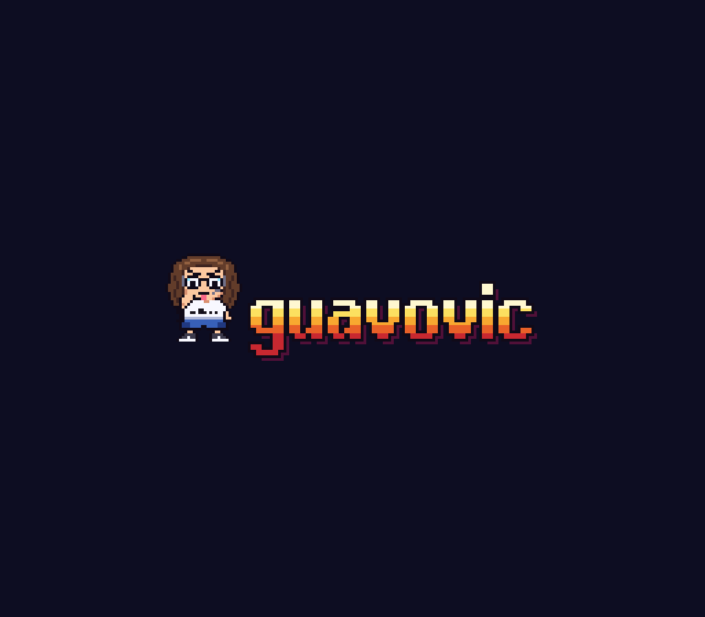
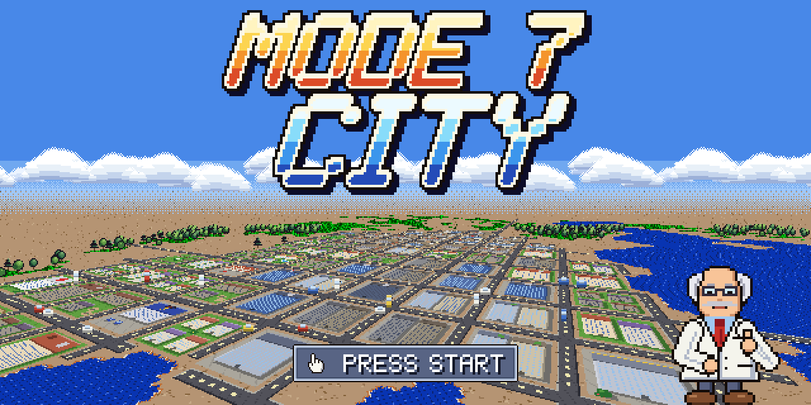
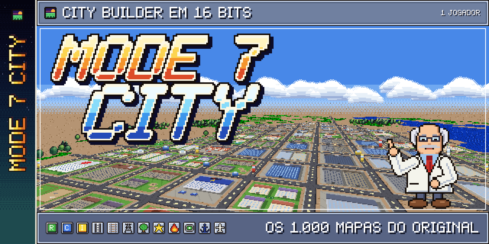
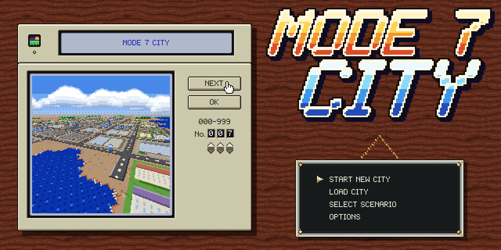
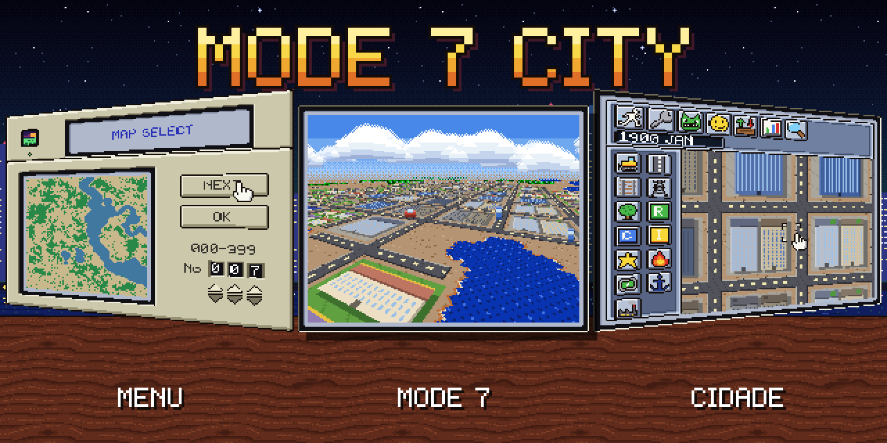

  

<h1 align="center">Mode 7 City</h1>

City builder em 16 bits feito em Unity, fiel ao <a href="https://pt.wikipedia.org/wiki/SimCity_(jogo_eletr%C3%B4nico_de_1989)">SimCity</a> de Super Nintendo (1991): os 1.000 mapas, as zonas, a energia, o trânsito, os desastres, os cenários e o Dr. Wright, com arte, música e sons próprios.

  <b><a href="https://github.com/guavovic/mode-7-city/releases">Baixar o jogo</a></b>

## Destaques

- **Os 1.000 mapas:** o menu escolhe entre os 1.000 terrenos do original, e a partida abre no mapa escolhido.
- **Simulação fiel:** zonas residenciais, comerciais e industriais, energia, trânsito, poluição, crime, valor do terreno, orçamento e avaliação do prefeito, no ritmo do SNES.
- **Desastres:** fogo, enchente, tornado, terremoto, monstro, queda de avião e derretimento da usina nuclear, pelo menu ou por sorteio.
- **Cenários:** San Francisco, Bern, Tokyo, Detroit, Boston e Rio de Janeiro, mais Las Vegas e Freeland de bônus.
- **Presentes:** casa do prefeito, biblioteca, zoológico, Expo, parque de diversões ou cassino e os outros presentes que a cidade ganha ao crescer.
- **Dr. Wright:** conselheiro, tutorial passo a passo e dicas na primeira vez que algo acontece.
- **Controle, teclado ou mouse:** os botões do Super Nintendo em qualquer controle, com o nome certo do botão em cada aparelho.
- **Arte própria em 16 bits:** tudo desenhado por script, na tela de 256 × 224 do SNES ampliada sem borrar, com estações do ano, chuva e neve.
- **Seis idiomas:** português, inglês, espanhol, francês, italiano e alemão.

## Versões

| Versão | O que traz | Quando |
|---|---|---|
| **v1.0** | o SimCity do SNES completo e fiel | feita |
| v1.0.x | correções depois do lançamento | conforme aparecem |
| v1.1 | a cidade conversa, a vida de prefeito e extras | novembro de 2026 |
| v2.0 | a expansão própria do Mode 7 City | janeiro de 2027 |

## Artes

Artes de divulgação montadas com os sprites, o HUD e o letreiro do próprio jogo, sobre a cidade do mapa 007.

## Direitos

© 2026 guavovic. Todos os direitos reservados.

Mode 7 City é um projeto de fã, sem fins lucrativos e sem vínculo com a Nintendo, a Maxis ou a Electronic Arts. SimCity é marca registrada da Electronic Arts. A arte, o código e os sons são próprios; as regras da simulação foram estudadas a partir do Micropolis (GPL), sem copiar código.

---

Feito por [Gustavo Victor](https://github.com/guavovic)
